<div align="center">


# Eventon

**A modern, fully responsive event discovery & registration platform.**
Explore hackathons, gigs, workshops and festivals, register in under 30 seconds and walk in with a QR ticket.

[**🌐 Live site → kexplore-events.vercel.app**](https://kexplore-events.vercel.app) &nbsp;·&nbsp;
[API health](https://kexplore-api.onrender.com/api/health) &nbsp;·&nbsp;
[Screenshots](#-screenshots) &nbsp;·&nbsp;
[Run locally](#-getting-started)


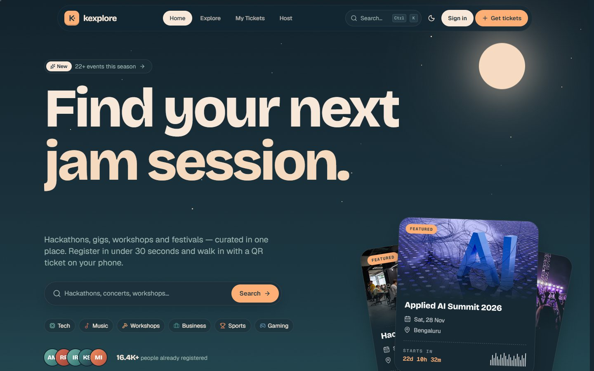

</div>

---

## 📚 Contents

1. [About the project](#-about-the-project)
2. [Design](#-design) — palette, dusk scene, FlexCarousel
3. [Requirements checklist](#-requirements-checklist)
4. [Bonus challenges](#-bonus-challenges--all-done)
5. [Beyond the brief](#-beyond-the-brief)
6. [Tech stack](#-tech-stack)
7. [Architecture](#-architecture)
8. [How it works](#-how-it-works) — validation, Local Storage, auth, seat counting
9. [Project structure](#-project-structure)
10. [API reference](#-api-reference)
11. [Getting started](#-getting-started)
12. [Deployment](#-deployment)
13. [Screenshots](#-screenshots)

---

## ✨ About the project

**Eventon** (formerly Kexplore, then Summit) was built for the *K Explore – Web Designing* task: *design and develop a responsive event management website where users can explore upcoming events, view details and register.*

It is a single-page React application backed by a small REST API and a MongoDB Atlas database:

- **Sign-in first** — the whole site sits behind a login page styled as an event pass (21st.dev *Login Form* with its smoky WebGL background). Create an account with email + password, or continue with Google; you land back on the page you asked for.
- **Home** — a low-poly *mountain-lake-at-dusk* hero (moon at night, sun at dawn) with live search, a WebGL **FlexCarousel** reel of the whole season, a featured-events bento grid, upcoming events grouped by month, category tiles, “how it works”, live stats and a **3D testimonial wall** (21st.dev *3D Testimonials*).
- **Explore** — search, category / date / price / format filters, sorting, grid ↔ list views and “load more” pagination. Filters live in the URL, so every result page is shareable.
- **Ratings & wishlist** — every event card and page has a React Bits **PeekRating** (rate 1–5, tap again to clear; the average and count are stored on the server) and a **PulseHeart** wishlist button showing how many people saved the event.
- **Event details** — cover hero with parallax, live countdown, seats meter, schedule, speakers, venue map, FAQ accordion, share and add-to-calendar.
- **Register** — a validated form (name, email, phone, selected event, tickets) with a **live ticket preview** that fills in as you type; you confirm by dragging the React Bits **SlideCommit** slider, then get confetti and a QR ticket.
- **My Tickets** — every registration is kept in **Local Storage** (works offline), synced with the server, exportable to JSON/CSV and importable.
- **Host** — sign in with Google to publish your own events and see who registered.

---

## 🎨 Design

The whole interface is built from one six-colour palette — *dusk over a mountain lake*:

| Swatch | Hex | Role |
| --- | --- | --- |
|  | `#213843` | **Deep** — dark surfaces, light-mode text, button ink |
|  | `#468D8B` | **Teal** — secondary accents, links, lake |
|  | `#74B3A8` | **Sage** — success states, highlights |
|  | `#F6DAC0` | **Cream** — dark-mode text, moon, light-mode canvas |
|  | `#FEAF76` | **Apricot** — primary actions (7:1 contrast with deep ink), sun |
|  | `#DA6D58` | **Terracotta** — mountains, warnings & errors, emphasis |

- **Dark mode = dusk** (deep-teal sky, cream type, a moon and stars); **light mode = dawn** (cream sky, deep type, a rising sun). Every colour is a CSS custom property, so the hero scene, ticket, map and charts re-tint with the theme.
- The hero landscape (`components/home/DuskScene.jsx`) is a hand-built SVG: layered low-poly peaks with parallax, a reflective lake with drifting light, and a bobbing sailboat.
- The **FlexCarousel** from [React Bits](https://reactbits.dev) (`npx shadcn@latest add @react-bits/FlexCarousel-JS-CSS`) renders the season’s event covers on WebGL through a liquid-glass lens — drag, swipe, arrow keys or autoplay; clicking the centred cover opens the event. It is lazy-loaded and falls back to a scroll-snap strip without WebGL 2.
- Typography: Bricolage Grotesque (display), Geist (text), Geist Mono (numbers).

---

## ✅ Requirements checklist

| Requirement from the brief | Where / how it’s implemented |
| --- | --- |
| Attractive **hero section** introducing the platform | `components/home/Hero.jsx` — split-text headline with rotating words, aurora gradient + grid + film grain, hero search, 3D-tilting featured ticket stack |
| **Upcoming & featured events** section | Featured **bento grid** (`FeaturedBento`) and **Coming up next** grid with month tabs (`UpcomingSection`) |
| **Event cards** with name, date, venue, image, short description | `components/events/EventCard.jsx` — plus category, price, live countdown, seats bar and bookmark |
| **Browse, search and filter by category** | `pages/Events.jsx` — debounced search (title, venue, city, tags, organiser), category pills, date range, price, format, sort |
| **Event details** page with registration option | `pages/EventDetail.jsx` — sticky registration card + mobile action bar |
| Registration form collecting **name, email, phone, selected event** | `pages/Register.jsx` — searchable event picker, name, email, phone (with country code), tickets, organisation |
| **JavaScript form validation** | `lib/validators.js` — pure validation functions with 26 unit tests; validated on blur and live after first touch, focus jumps to the first error, inline messages with `aria-invalid` |
| **Confirmation message** on success | Success dialog with confetti, QR ticket, “save as image” and “add to calendar” + toast |
| **Responsive** — mobile, tablet, desktop | Mobile-first Tailwind layouts, hamburger menu, bottom-sheet filters, sticky mobile CTA, fluid `clamp()` typography; no horizontal scroll at 375 px |
| Good UI/UX, consistent styling, **smooth transitions, interactive elements** | Design tokens, spring animations (Motion), Lenis smooth scrolling, hover spotlights, skeleton loaders, empty/error states, command palette |
| **HTML5, CSS3, JavaScript** (+ optional **Tailwind CSS** & **React.js**) | Semantic HTML5 landmarks, CSS custom properties & keyframes, modern JavaScript (ES2023), React 19, Tailwind CSS v4 |
| **Git & GitHub** | This repository, with CI on every push (`.github/workflows/ci.yml`) |
| **Deployed** website | Frontend on **Vercel**, API on **Render**, database on **MongoDB Atlas** |
| **README** explaining the project | You’re reading it 👋 |

## 🏆 Bonus challenges — all done

| Bonus | Implementation |
| --- | --- |
| 🌗 **Dark / light mode** | `context/ThemeContext.jsx` — follows the OS by default, remembers your choice, no flash on load (inline script in `index.html`), and switches with a **circular reveal animation** using the View Transitions API |
| ⏳ **Event countdown timers** | `components/events/Countdown.jsx` — flip-style digits on the event page and ticket view, compact live timers on every card |
| 🎞️ **Animations** | Motion (Framer Motion) springs, scroll reveals, shared-layout pills, split-text headlines, 3D tilt, parallax mountains, a WebGL liquid-glass carousel, marquees, confetti — all toned down automatically for `prefers-reduced-motion` |
| 💾 **Local Storage registration management** | `lib/storage.js` — tickets, saved events, recently viewed, form profile and view preferences persist on the device. The **My Tickets** page lets you view, cancel, sync, export (JSON/CSV), import and clear them; stores stay in sync across tabs via the `storage` event |

## 🚀 Beyond the brief

- **Real backend + database** — Express 5 REST API with MongoDB Atlas; registrations are stored server-side *and* on the device.
- **Google sign-in** — custom “Continue with Google” button (OAuth popup + authorization-code exchange on the server) and **Google One Tap**. Sessions are JWTs in `httpOnly` cookies.
- **Race-safe seat counting** — registrations run inside a **MongoDB transaction**; a unique index stops the same email registering twice for an event.
- **QR tickets** — each ticket has a QR code that opens a shareable ticket page (personal details are masked for anyone but the owner). Save as PNG, print, or add to Google/Apple/Outlook calendar (`.ics` with a 2-hour reminder).
- **Command palette** — press <kbd>Ctrl</kbd>/<kbd>⌘</kbd> + <kbd>K</kbd> or <kbd>/</kbd> anywhere to search events, jump to pages or toggle the theme.
- **Smart form UX** — “Did you mean `gmail.com`?” email typo detection, country-aware phone rules with auto-formatting, progress bar, duplicate detection before the request is even sent, server errors mapped back onto fields.
- **Host dashboard** — publish events (with live cover preview), track registrations and page views, view the attendee list.
- **Saved events** — heart any event; synced to your account when signed in.
- **Performance** — route-level code splitting, lazy images, self-hosted variable fonts, CDN caching of event lists (`s-maxage` + `stale-while-revalidate` on Vercel’s edge), API warm-up ping and a keep-alive workflow for the free Render instance.
- **Accessibility** — skip link, landmarks, labelled controls, keyboard-navigable dropdowns/listboxes/dialogs with focus trapping, visible focus rings, live regions for results.
- **Quality** — ESLint (React Hooks rules), Vitest unit tests, GitHub Actions CI, Zod validation on the server, Helmet security headers, rate limiting.

---

## 🧰 Tech stack

| Layer | Technologies |
| --- | --- |
| **Frontend** | React 19, Vite 8, Tailwind CSS 4, React Router 7, TanStack Query 5, Motion, Lenis, React Bits (FlexCarousel on ogl / WebGL 2, PeekRating, PulseHeart, SlideCommit), 21st.dev components, Hugeicons, cmdk, Sonner, qrcode.react, canvas-confetti, html-to-image, lucide-react, date/number formatting via `Intl` |
| **Backend** | Node.js 22, Express 5, Mongoose 9, Zod 4, google-auth-library, jsonwebtoken, Helmet, express-rate-limit, compression |
| **Database** | MongoDB Atlas (M0, AWS Singapore) |
| **Auth** | Google Identity Services (OAuth 2.0 popup code flow + One Tap) |
| **Hosting** | Vercel (frontend + `/api` rewrite), Render (API) |
| **Tooling** | ESLint 10, Vitest, GitHub Actions |
| **Fonts** | Bricolage Grotesque (display), Geist (text), Geist Mono (numbers) — self-hosted via Fontsource |

---

## 🏗️ Architecture

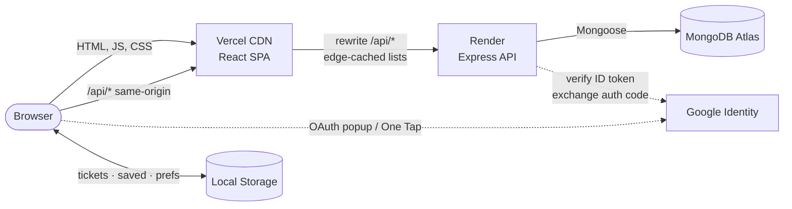

- The browser only ever talks to **one origin**. Vercel rewrites `/api/*` to Render, so the session cookie is first-party (works in Safari and with third-party cookies blocked) and no CORS preflights are needed.
- Event lists and details are sent with `Cache-Control: s-maxage, stale-while-revalidate`, so Vercel’s edge serves them instantly even while the free Render instance wakes up.
- Local Storage is the offline cache and the guest “account”; the API is the source of truth (`POST /api/registrations/sync` reconciles them).

---

## ⚙️ How it works

### Form validation

Validation lives in pure functions (`client/src/lib/validators.js`) so it’s unit-tested and reused by the live ticket preview. The server re-validates everything with Zod (`server/src/validators/schemas.js`).

| Field | Rules |
| --- | --- |
| Event | required; sold-out events can’t be picked; tickets are capped at the seats left |
| Full name | 2–60 characters, letters (any language), spaces, `.` `'` `-` |
| Email | required, no spaces, single `@`, no `..`, valid domain + TLD; suggests fixes for common typos |
| Phone | per-country rules (🇮🇳 10 digits starting 6–9, 🇺🇸, 🇬🇧, 🇦🇪, 🇸🇬, 🇦🇺); auto-formatted; sent as E.164 (`+919876543210`) |
| Tickets | whole number, 1 – 4 |
| Organisation | optional, ≤ 80 characters |
| Code of conduct | must be accepted |
| Duplicates | blocked locally (Local Storage) **and** by a unique index in MongoDB |

Errors appear after a field is touched, update live while typing, and on submit the form shakes, announces the error count and focuses the first invalid field.

### Local Storage data model

| Key | Contents |
| --- | --- |
| `kexplore:registrations:v1` | array of tickets: `ticketCode`, `eventId`, event snapshot (title, dates, venue, cover…), `name`, `email`, `phone`, `tickets`, `status`, `createdAt`, `syncedAt` |
| `kexplore:saved:v1` | saved (bookmarked) event snapshots |
| `kexplore:recent:v1` | last 6 viewed events (used by the command palette) |
| `kexplore:profile` | name / email / phone remembered to pre-fill the next registration |
| `kexplore:theme`, `kexplore:view` | theme and grid/list preference |

Each store is a tiny observable (`subscribe` / `getSnapshot`) read with React’s `useSyncExternalStore`, so every component updates instantly — even across browser tabs. All reads/writes are wrapped in `try/catch` so private browsing never breaks the app.

### Authentication

Every route except `/login` is wrapped in `<RequireAuth>`, which waits for `/api/auth/me` (retrying while the free-tier API wakes up) and redirects signed-out visitors to `/login?next=…`.

**Email + password:** `POST /api/auth/signup` validates the name, email and password (8+ characters with letters and numbers) and stores an **scrypt** hash (`N=2¹⁵`, per-user salt, constant-time compare). `POST /api/auth/login` answers wrong passwords and unknown emails with the same message and timing. Signing in with Google later using the same email links to the same account.

**Google:**

1. The **Continue with Google** button opens Google’s popup (`flow: 'auth-code'`); One Tap returns an ID token directly.
2. The API exchanges the code with the client secret (or takes the ID token), verifies it with `google-auth-library`, and upserts the user.
3. A 7-day JWT is set as an `httpOnly`, `SameSite=Lax`, `Secure` cookie.
4. Tickets booked earlier with the same email are linked to the account and synced to the device.

### Seat counting

`POST /api/registrations` runs in a MongoDB transaction: check the event is open → check for a duplicate → atomically `$inc` the seat counter **only if** `registeredCount + tickets ≤ capacity` → create the registration. Cancelling releases the seats the same way.

---

## 🗂️ Project structure

```
.
├── client/                     # React SPA (deployed to Vercel)
│   ├── public/                 # favicon, social preview image
│   └── src/
│       ├── components/
│       │   ├── auth/           # Google button, sign-in dialog, One Tap
│       │   ├── events/         # EventCard, Countdown, seats meter, share, calendar
│       │   ├── home/           # Hero, dusk scene, season carousel, landing sections
│       │   ├── reactbits/      # FlexCarousel, PeekRating, PulseHeart, SlideCommit (React Bits)
│       │   ├── twentyfirst/    # Login form + 3D testimonial marquee (21st.dev, adapted)
│       │   ├── layout/         # Navbar, Footer, command palette, root layout
│       │   ├── registration/   # Form fields, event picker
│       │   ├── tickets/        # TicketCard (QR ticket)
│       │   └── ui/             # Button, Dialog, Dropdown, Badge, effects…
│       ├── context/            # Theme + Auth providers
│       ├── hooks/              # countdown, debounce, queries, Local Storage stores
│       ├── lib/                # api client, validators, storage, formatting, calendar
│       └── pages/              # Home, Events, EventDetail, Register, Tickets, TicketView, Host
├── server/                     # Express API (deployed to Render)
│   └── src/
│       ├── config/             # env + MongoDB connection
│       ├── controllers/        # events, registrations, auth, users
│       ├── data/               # seed catalogue (24 events)
│       ├── middleware/         # auth, validation, errors
│       ├── models/             # Event, Registration, User (Mongoose)
│       ├── routes/             # REST routes + rate limits
│       ├── scripts/seed.js     # database seeding
│       └── validators/         # Zod schemas
├── docs/screenshots/
├── .github/workflows/          # CI + keep-alive
├── vercel.json                 # build settings, /api rewrite, headers
└── render.yaml                 # Render blueprint for the API
```

---

## 🔌 API reference

Base URL: `https://kexplore-events.vercel.app/api` (proxied) or `https://kexplore-api.onrender.com/api`.

| Method | Endpoint | Description |
| --- | --- | --- |
| `GET` | `/health` | Uptime and database status |
| `GET` | `/events` | List events. Query: `q`, `category`, `when` (`upcoming`·`week`·`month`·`past`·`all`), `price` (`free`·`paid`), `mode` (`offline`·`online`), `sort` (`date`·`popular`·`price`·`newest`), `featured`, `page`, `limit` |
| `GET` | `/events/meta` | Category counts, cities and platform stats |
| `GET` | `/events/:slug` | Event details + related events |
| `POST` | `/events` | 🔒 Create an event (host) |
| `GET` | `/events/hosted` | 🔒 Events you host |
| `GET` | `/events/:id/attendees` | 🔒 Attendees of your event |
| `POST` | `/registrations` | Register `{ eventId, name, email, phone, tickets, organization }` |
| `GET` | `/registrations/:code` | Ticket by code (PII masked unless you own it) |
| `PATCH` | `/registrations/:code/cancel` | Cancel `{ email }` (or as the signed-in owner) |
| `POST` | `/registrations/sync` | Statuses for a list of ticket codes (Local Storage reconciliation) |
| `GET` | `/registrations/me` | 🔒 Your tickets |
| `POST` | `/auth/signup` | Create an account `{ name, email, password }` |
| `POST` | `/auth/login` | Sign in `{ email, password }` |
| `POST` | `/auth/google` | Sign in with `{ code }` or `{ credential }` |
| `GET` | `/auth/me` · `POST` `/auth/logout` | Session |
| `GET` · `PUT` | `/users/me/bookmarks[/:eventId]` | 🔒 Saved events (the toggle returns the event’s new `savesCount`) |
| `PUT` | `/events/:eventId/rating` | 🔒 Rate `{ value: 1–5 }` or clear with `0`; returns the new average and count |
| `GET` | `/users/me/ratings` | 🔒 Your ratings as `{ eventId: value }` |

Validation errors return `422` with field-level `details`, e.g. `{ "error": "Please fix the highlighted fields", "details": { "email": "Enter a valid email address" } }`.

---

## 🛠️ Getting started

**Prerequisites:** Node.js ≥ 20.12, a MongoDB connection string (Atlas free tier works) and a Google OAuth *Web* client ID with `http://localhost:5173` as an authorised JavaScript origin.

```bash
git clone https://github.com/Rishiraj-De/Kexplore-Event-Management.git
cd Kexplore-Event-Management

# 1) API
cd server
cp .env.example .env        # fill in MONGODB_URI, JWT_SECRET, GOOGLE_CLIENT_ID, GOOGLE_CLIENT_SECRET
npm install
npm run seed                # loads 24 demo events
npm run dev                 # http://localhost:4000

# 2) Web app (new terminal)
cd client
cp .env.example .env.local  # set VITE_GOOGLE_CLIENT_ID
npm install
npm run dev                 # http://localhost:5173 (proxies /api → :4000)
```

| Script | Where | What it does |
| --- | --- | --- |
| `npm run dev` | client / server | Dev server with hot reload / file watching |
| `npm run build` | client | Production build to `client/dist` |
| `npm run lint` | client | ESLint |
| `npm test` | client | Vitest unit tests (validators, formatting, Local Storage backups) |
| `npm run seed` / `seed:reset` | server | Upsert demo events / wipe and re-seed |

### Environment variables

| Variable | Used by | Purpose |
| --- | --- | --- |
| `MONGODB_URI` | API | MongoDB Atlas connection string |
| `JWT_SECRET` | API | Signs session cookies |
| `GOOGLE_CLIENT_ID` / `GOOGLE_CLIENT_SECRET` | API | Verify Google tokens and exchange auth codes |
| `CLIENT_URL` | API | Extra comma-separated origins allowed by CORS |
| `VITE_GOOGLE_CLIENT_ID` | Web | Google Identity Services client ID |
| `VITE_API_URL` | Web | *(optional)* call an API on another origin instead of `/api` |

`.env` files are git-ignored — only the `.env.example` templates are committed.

---

## ☁️ Deployment

| Piece | Platform | Notes |
| --- | --- | --- |
| Web app | **Vercel** — [kexplore-events.vercel.app](https://kexplore-events.vercel.app) | Built from the repo root with `vercel.json` (`client/` build, SPA fallback, `/api/*` → Render rewrite, immutable asset caching) |
| API | **Render** — [kexplore-api.onrender.com](https://kexplore-api.onrender.com/api/health) | Free web service in Singapore, `rootDir: server`, health check `/api/health`, auto-deploys from `main` (see `render.yaml`) |
| Database | **MongoDB Atlas** | M0 cluster on AWS `ap-southeast-1`, dedicated least-privilege user (`readWrite` on the `kexplore` database) |
| Keep-alive | **GitHub Actions** | Pings the API every 10 minutes so the free instance stays warm |

---

## 📸 Screenshots

| Dark | Light |
| --- | --- |
|  | 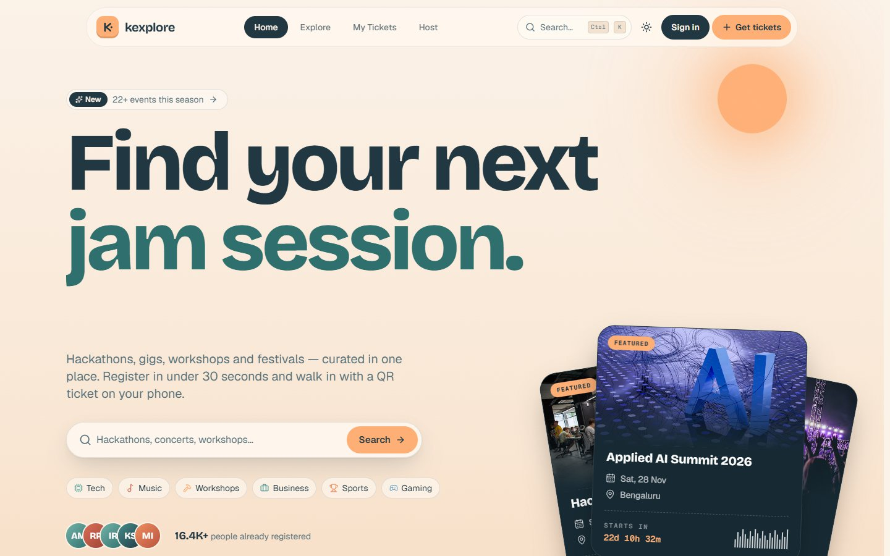 |
| 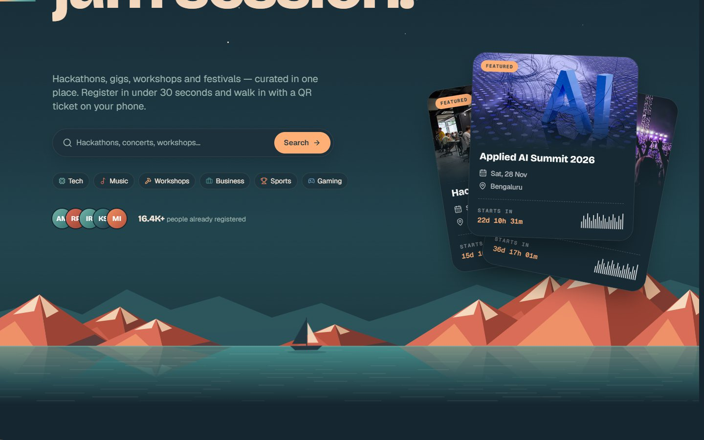 | 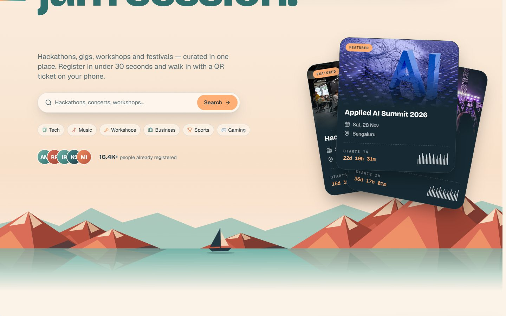 |
| 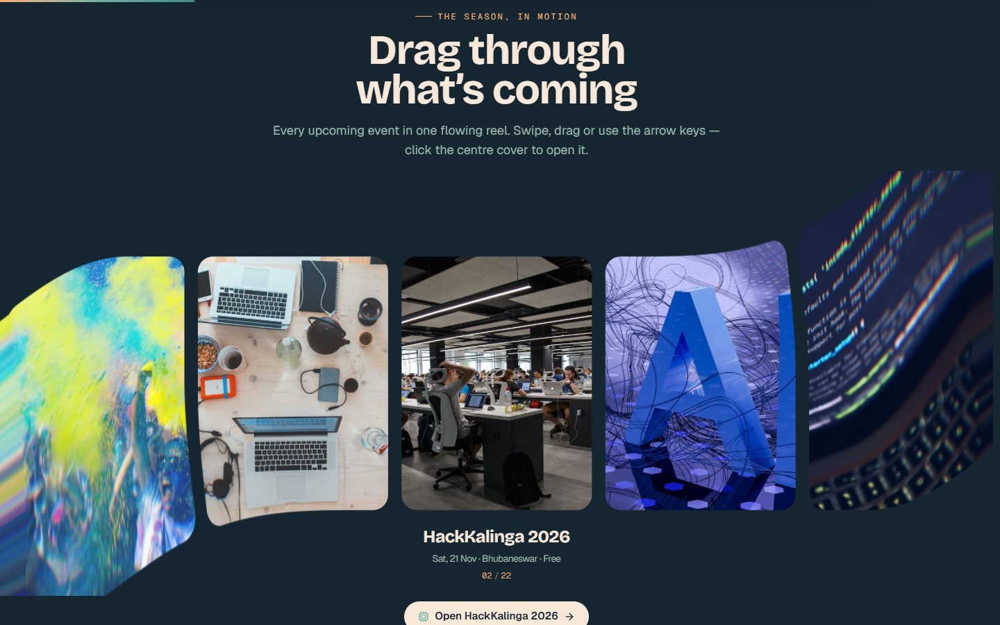 | 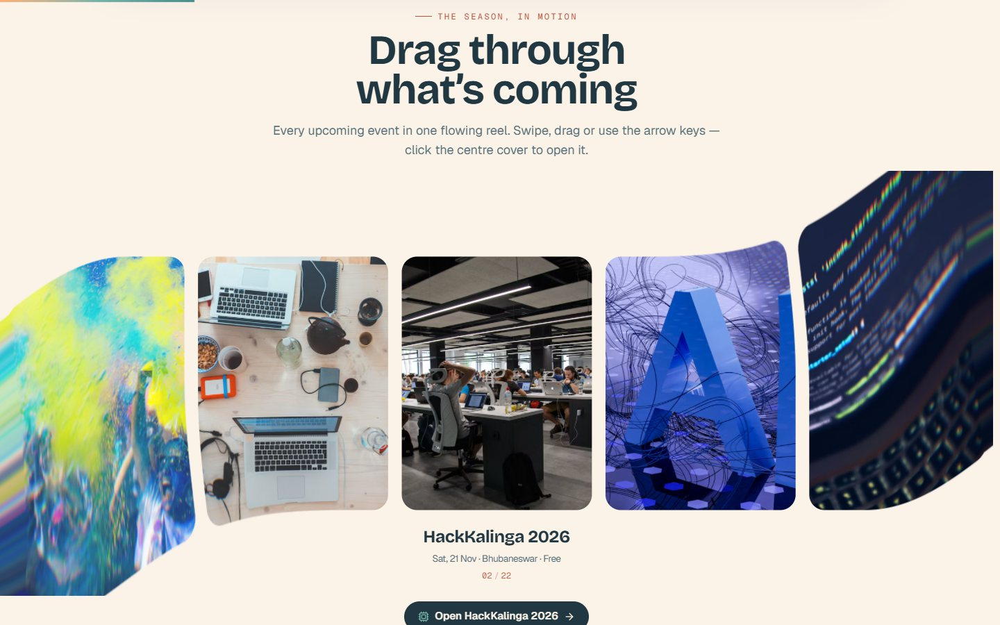 |
| 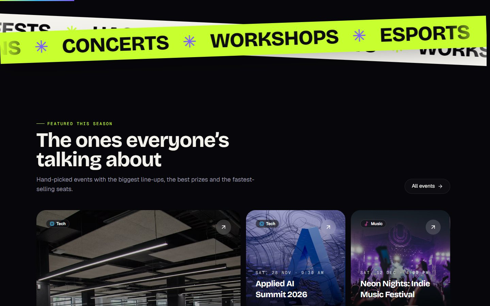 | 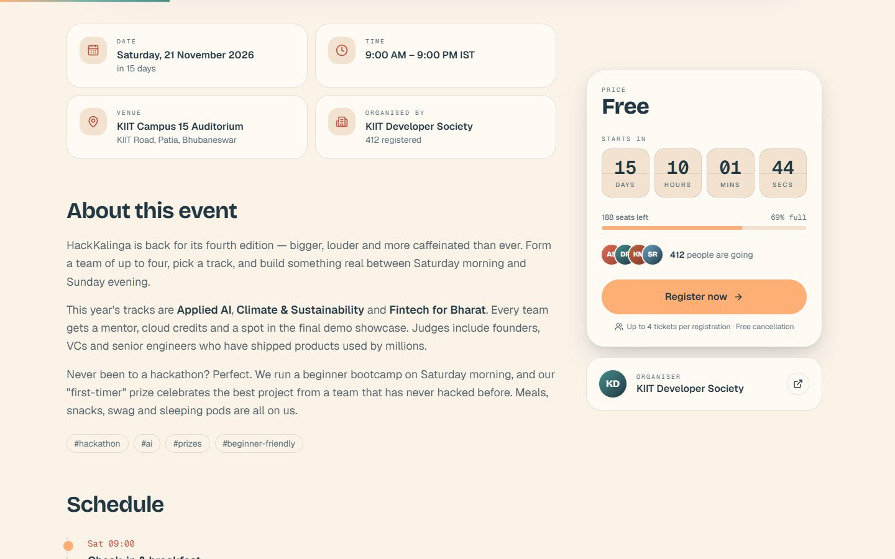 |
| 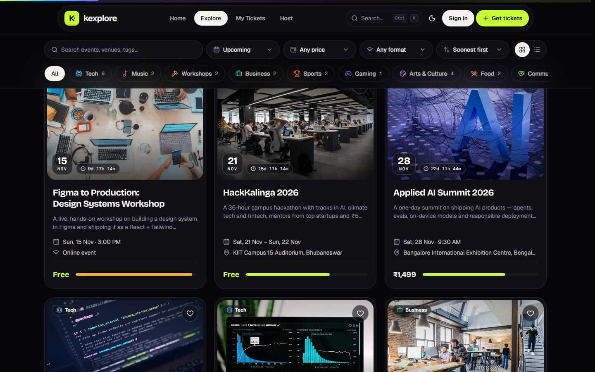 | 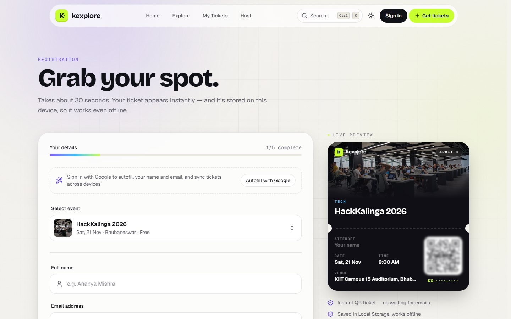 |
| 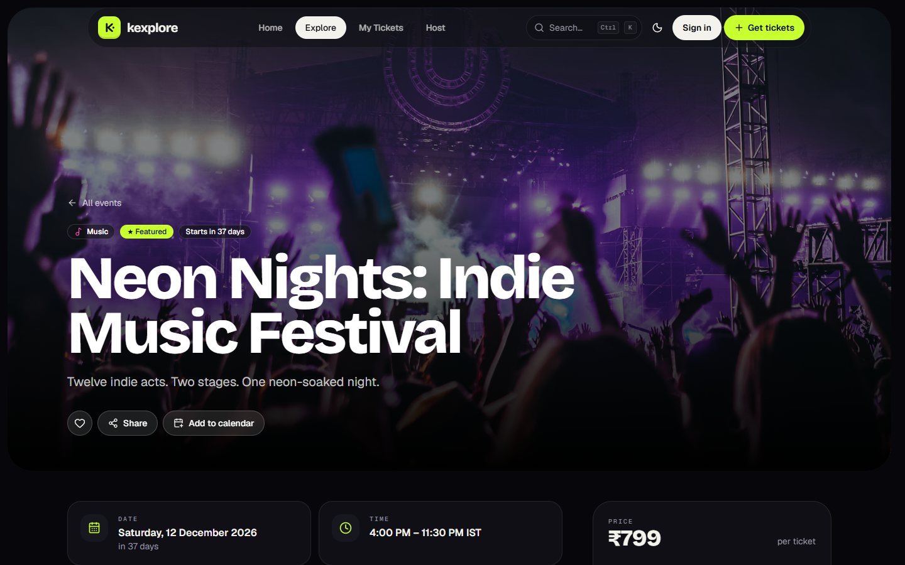 | |

<p align="center">
  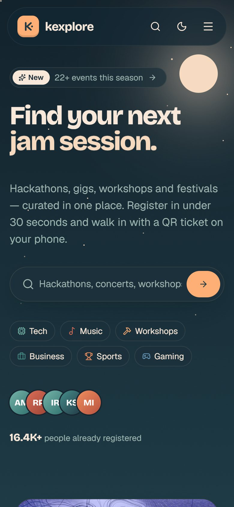
  &nbsp;&nbsp;
  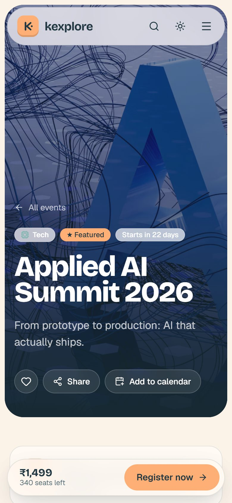
</p>

---

## 🙏 Credits

- Event photography from [Unsplash](https://unsplash.com) (Unsplash License). Event names, organisers and people are fictional demo data.
- [React Bits](https://reactbits.dev): FlexCarousel, PeekRating, PulseHeart and SlideCommit (vendored in `client/src/components/reactbits/`).
- [21st.dev](https://21st.dev): *Login Form* by minhxthanh and *3D Testimonials* by sean0205, adapted in `client/src/components/twentyfirst/`. UI inspiration: Aceternity UI, Dribbble and Mobbin; every other component was written for this project.
- Colour palette inspired by a dusk mountain-lake poster by Luca Davincci.
- Icons by [Lucide](https://lucide.dev); fonts by [Fontsource](https://fontsource.org).

<div align="center">
<sub>Built for <b>K Explore — Web Designing</b> · HTML5 · CSS3 · JavaScript · React · Tailwind CSS</sub>
</div>
